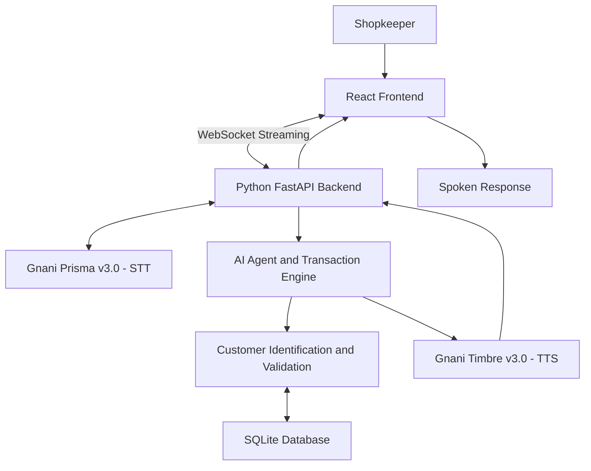

# Voice ಖಾತರಿ (Voice Khatari)

### Your Shop. Your Voice. Your Trusted Khata.

## About the Project

Voice ಖಾತರಿ is a multilingual, voice-first digital khata designed for small kirana stores in India.

Many local shopkeepers still manage customer credit and payment records using handwritten notebooks, paper slips or memory. This can lead to incorrect balances, missing transactions, difficulty tracking payments and disputes between shopkeepers and customers.

Voice ಖಾತರಿ simplifies this process by allowing shopkeepers to maintain their digital ledger through natural voice conversations in Indian languages, including English code-mixing.

Instead of manually entering every transaction, a shopkeeper can simply speak to the agent to record credit, update payments, check customer balances and retrieve daily transaction summaries.

## Key Features

- **Voice-Based Transactions:** Record customer credit and payments through natural speech.
- **Multilingual Interaction:** Understand supported Indian languages and English code-mixing.
- **Smart Customer Identification:** Identify customers and clarify when multiple customers have the same name.
- **Context-Aware Corrections:** Handle corrections before confirming and saving transactions.
- **Digital Customer Ledger:** Maintain customer-wise balances and transaction history.
- **Voice-Based Queries:** Retrieve outstanding balances, daily credit and payment summaries through conversation.
- **Transaction Accountability:** Maintain validated transaction records and an audit trail.

## System Architecture

Voice ಖಾತರಿ follows a real-time, WebSocket-based voice agent architecture.

### How It Works

1. **Voice Input:** The shopkeeper speaks through the application's microphone.
2. **Speech Recognition:** Gnani Prisma v3.0 converts speech into text.
3. **Transaction Understanding:** The AI agent extracts the customer name, amount, transaction type and date.
4. **Validation:** Customer identity and transaction details are checked. Ambiguous requests are clarified before saving.
5. **Ledger Management:** Validated transactions are stored in the database.
6. **Voice Response:** Gnani Timbre v3.0 converts the agent's response into speech and delivers it to the shopkeeper.

## Technology Stack

| Layer | Technology |
|---|---|
| Frontend | React, Tailwind CSS |
| Backend | Python, FastAPI |
| Communication | WebSocket |
| Speech-to-Text | Gnani Prisma v3.0 |
| Text-to-Speech | Gnani Timbre v3.0 |
| Voice Orchestration | Pipecat |
| AI Reasoning | LLM |
| Database | SQLite |

## Gnani API Platform

The project uses the following required Gnani services:

- **Prisma v3.0:** Real-time speech-to-text processing.
- **Timbre v3.0:** Natural text-to-speech generation.

Both services are integrated into the voice interaction pipeline using WebSocket streaming.

## Privacy and Security

- API keys are stored securely in environment variables.
- Customer transactions are validated before being saved.
- Customer ledger data is protected against unauthorized access.
- Only synthetic or consented data is used for demonstrations.

## Hackathon

**Event:** BolBharat – The Gnani Voice AI Innovation Challenge

**Selected Problem Statement:** PS 2 – Voice Khata for Kirana Stores

**Project Name:** Voice ಖಾತರಿ (Voice Khatari)

